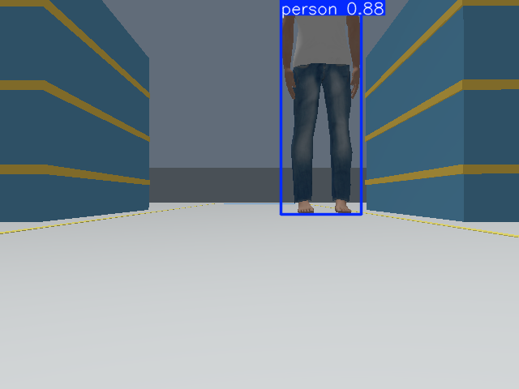

# FactoryNav AI

TurtleBot3 material transport with ROS 2 Jazzy, Gazebo Harmonic, Nav2, and LiDAR.
Development workspace: `D:\cele`. Factory navigation, unexpected-obstacle
avoidance, and live YOLO26 detection on simulated camera images are verified.

## Assignment checklist

- [x] TurtleBot3, Gazebo, RViz, LiDAR, odometry, localization, and Nav2.
- [x] Autonomous goals and repeated unexpected-obstacle avoidance.
- [x] Reproducible factory world, matching map, scripts, and test evidence.
- [x] Real RGB camera → YOLO26 → structured ROS detections and annotations.
- [x] Baseline navigation works with YOLO disabled and with YOLO enabled.
- [x] Setup instructions, recording plan, and submission answers.
- [ ] Semantic person-aware velocity control (optional; not implemented).
- [ ] Public GitHub publication and video recording (not performed).

## Local Conda environment

The Conda environment is installed inside this directory at `.conda`, using
Python 3.12, pip, NumPy, and PyYAML. It is for Windows development tooling.

Create it with the existing Conda installation:

```powershell
.\setup\create_env.ps1
```

Activate in PowerShell:

```powershell
. .\setup\activate.ps1
```

Or, from an Anaconda Prompt:

```bat
conda activate D:\cele\.conda
```

Check the interpreter:

```powershell
python -c "import sys; print(sys.executable); print(sys.version)"
```

Verified versions: Python 3.12.16, NumPy 1.26.4, PyYAML 6.0.3. Activation,
imports, basic operations, and `pip check` passed.

The environment definition is in `environment.yml`. Exact Windows packages are
saved in `conda-win-64.lock.txt`. Recreate them with:

```powershell
& 'D:\ana3\Scripts\conda.exe' create --prefix .\.conda --file .\conda-win-64.lock.txt --yes
```

Conda base is unchanged.

## Start the factory demo

Requirements: WSL2, Docker Desktop using Linux containers, internet for the first
build, and storage for the ROS/Gazebo images. The tested machine has 16 GB RAM
and an RTX 4060. The virtual desktop uses software OpenGL; GPU acceleration is
not required for the tested core demo.

```powershell
docker desktop start
.\scripts\run_demo.ps1 -Build
```

Open the [Gazebo and RViz desktop](http://localhost:6080/vnc.html?autoconnect=1&resize=scale).
Its port is bound to this machine's loopback interface. Reconnect or reload the
page after a container reset.

Send the Loading → Workstation B mission:

```powershell
docker compose exec -T simulation bash -lc 'source /opt/ros/jazzy/setup.bash; python3 /workspace/scripts/send_goal.py --x 4.5 --y 0 --initial-x -4.5 --initial-y 0'
```

Insert a blockage manually while the robot is moving:

```powershell
docker compose exec -T simulation bash -lc 'source /opt/ros/jazzy/setup.bash; python3 /workspace/scripts/spawn_obstacle.py'
```

Or run the repeatable test. It inserts the obstacle after 1 metre of observed
travel and requires costmap marking, a detour, and a successful action result:

```powershell
.\scripts\run_tests.ps1 -Scenario dynamic -Repeat 2
```

Every repetition recreates only this project's simulation container for a clean
world. Source files and logs persist in the workspace.

## Official baseline and ROS packages

```powershell
.\scripts\run_demo.ps1 -Baseline
.\scripts\run_tests.ps1 -Scenario baseline -Repeat 1
docker compose exec -T simulation bash /workspace/scripts/build_ros.sh
```

Both `factorynav_bringup` and `factorynav_perception` built with colcon. On native
Ubuntu 24.04 with the same ROS dependencies, use:

```bash
bash scripts/run_demo.sh --factory --gui
```

## Factory layout and results

`factorynav_bringup/config/factory_scene.json` defines walls, storage racks,
workbenches, pallets, and colored station pads. `scripts/generate_factory.py`
generates the Gazebo collision world and its matching 5 cm occupancy map from
that definition. This is analytic mapping, not a claim of SLAM-based mapping.

A red 0.7 × 2.2 × 1.0 m obstacle closes the central aisle after motion begins.
Alternative routes around the rack ends remain open. Existing Nav2 costmaps,
planning, control, recovery, and Collision Monitor handle the response.

| Scenario | Result | Wall time | Odometry travel | Minimum LiDAR range |
| --- | --- | ---: | ---: | ---: |
| Official baseline | PASS | 12.90 s | 3.47 m | 0.363 m |
| Factory, open aisle | PASS | 25.95 s | 8.93 m | 0.918 m |
| Unexpected obstacle, run 1 | PASS | 44.55 s | 14.54 m | 0.806 m |
| Unexpected obstacle, run 2 | PASS | 45.35 s | 14.63 m | 0.811 m |

Range is measured from the LiDAR sensor, not the robot footprint edge. Travel
is integrated odometry. See [the test report](docs/test_results.md) and
[raw results](docs/test_runs/).

## Optional YOLO26 camera layer

The optional image has a separate Linux Python environment with pinned
Ultralytics, PyTorch CPU, OpenCV, and NumPy. It adds an RGB camera, CameraInfo,
optical TF, and a latest-frame inference worker. The detector publishes
structured detections, annotations, and timing metrics; it has no velocity
publisher. Live detection validation passed with 28 distinct person frames,
valid CameraInfo and optical TF, and matching image/detection/annotation stamps.
Median inference was 47.25 ms on CPU in the 15-second observation. A mission
with perception running and the person present also passed in 29.75 seconds.



```powershell
.\scripts\run_demo.ps1 -Perception -Build
docker compose exec -T simulation python3 /workspace/setup/fetch_person.py
docker compose exec -T simulation bash -lc 'source /opt/ros/jazzy/setup.bash; python3 /workspace/scripts/spawn_person.py'
docker compose exec -T simulation bash -lc 'source /opt/ros/jazzy/setup.bash; python3 /workspace/scripts/verify_perception.py'
```

Topics: `/camera/image_raw`, `/camera/camera_info`, `/perception/detections`,
`/perception/annotated`, and `/perception/metrics`. `requirements.txt` describes
the Linux perception environment; the Windows Conda environment remains tooling
only. CUDA inference has not been validated.

To display the live annotated stream on the same virtual desktop:

```powershell
docker compose exec -d simulation bash -lc 'source /opt/ros/jazzy/setup.bash; DISPLAY=:99 ros2 run rqt_image_view rqt_image_view /perception/annotated'
```

Close the image-view window when finished, or stop the project container. Model
weights and downloaded assets remain outside Git. Exact wheel checksums and the
tested model hash are recorded under `setup/`; installed Python versions are
in `docs/perception-python.lock.txt`.

The textured person is by Marina Kollmitz through
[OSRF gazebo_models](https://github.com/osrf/gazebo_models/tree/master/person_standing),
under the repository's [CC-BY-3.0 license](https://creativecommons.org/licenses/by/3.0/). Cached assets have a pinned source
revision and checksums in `setup/person_assets.lock.json`.

## Versions, limitations, and submission

Verified runtime: Ubuntu 24.04.5, Python 3.12.3, ROS 2 Jazzy, Nav2 1.3.13,
Gazebo Sim 8.15.0, and RViz 14.1.24. The existing WSL Ubuntu 26.04 is preserved.
The selected robot is the official compatible TurtleBot3 Waffle.

YOLO boxes do not supply metric distance. Camera–LiDAR association and semantic
stopping are not implemented. LiDAR collision avoidance operates independently.

```powershell
docker compose logs -f simulation
docker compose down
```

See [setup](docs/setup.md), [architecture](docs/architecture.md),
[troubleshooting](docs/troubleshooting.md), [the recording plan](docs/demo_script.md),
[submission answers](docs/submission_answers.md), and [credits](docs/credits.md).
No video or public repository has been published. Publishing requires user
authorization.
