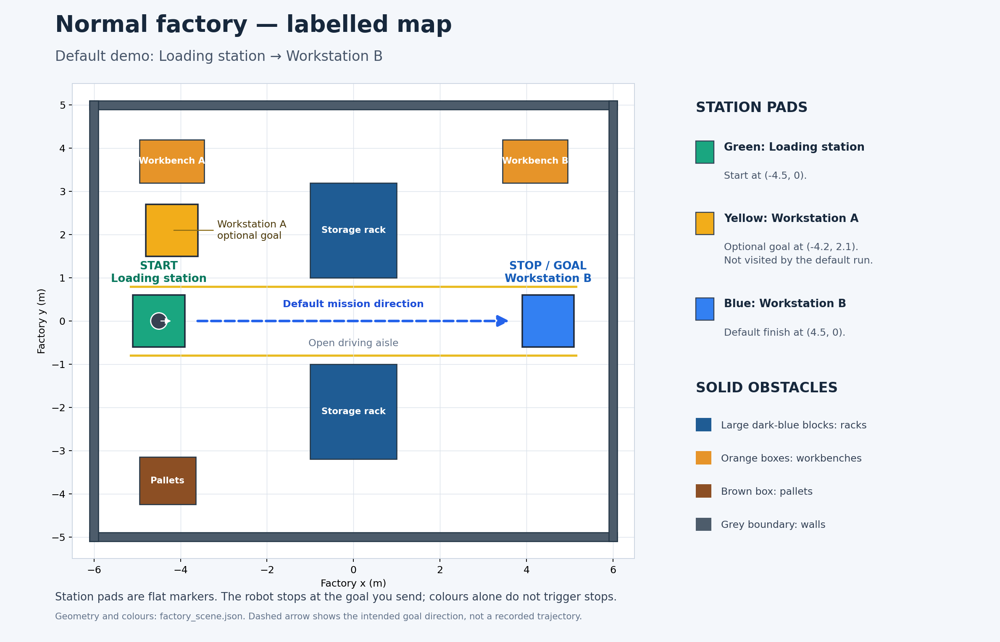
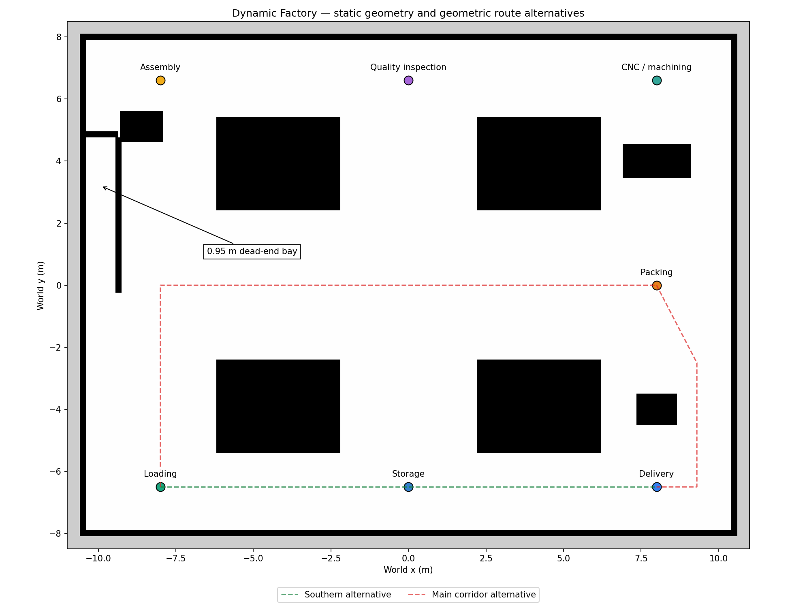
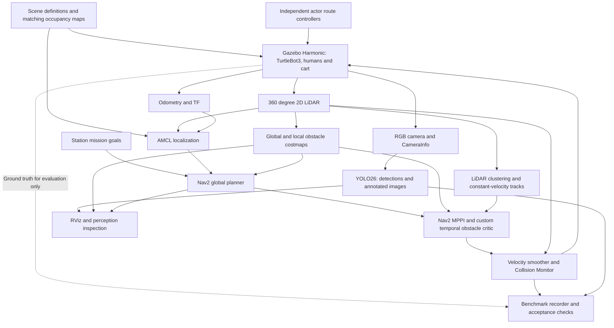

<div align="center">

# FactoryNav

### Motion-aware autonomous navigation for a simulated factory

TurtleBot3 · ROS 2 Jazzy · Gazebo Harmonic · Nav2 · LiDAR · MPPI · YOLO26

[](https://docs.ros.org/en/jazzy/) [](https://gazebosim.org/docs/harmonic/) [](https://docs.nav2.org/jazzy/configuration_and_development/configuration_guide/controller_plugins/mppi_controller/configuring_mppic/) [](factorynav_mppi_critics/) [](environment.yml) [](factorynav_perception/) [](compose.yaml) [](LICENSE)

**17/17 advanced trials accepted** · **3/3 continuous head-on passes** · **3/3 full missions**

[Quick start](#quick-start) · [Measured results](#measured-results) · [Architecture](#architecture) · [Limitations](#limitations) · [Documentation](#documentation)

</div>

## Two factories, one navigation stack

<table>
  <tr>
    <th width="50%">Original normal factory</th>
    <th width="50%">Advanced complex factory</th>
  </tr>
  <tr>
    <td align="center"><a href="media/normal_factory_map.png"></a></td>
    <td align="center"><a href="media/dynamic_factory_map.png"></a></td>
  </tr>
  <tr>
    <td>Loading → Workstation B through the central aisle. An unexpected stationary blockage tests replanning around the racks.</td>
    <td>Seven stations, alternate routes, crossing aisles and a 0.95 m bay. Independent moving humans and a cart exercise the custom motion-aware controller.</td>
  </tr>
</table>

Both PNGs are generated from the project's actual scene/map geometry. Dashed lines illustrate goal direction or geometric alternatives; they are not measured robot trajectories. Station colours identify locations; navigation goals determine where the robot stops.

## The project

Created and maintained by **[Abhinav Reddy](https://github.com/abhinavg08)**.

FactoryNav moves a simulated TurtleBot3 Waffle between factory stations while handling fixed equipment, newly introduced blockages and independently moving traffic. The original factory provides a simple, reproducible starting point. The advanced factory adds LiDAR motion estimation and a native C++ MPPI critic that scores the robot and obstacles at matching future times.

The engineering focus is measurable behaviour: successful actions, footprint clearance, physical contacts, sensor observations, stopped time, recoveries and resource use. Saved development failures accompany the accepted trials.

### Features

- **Complete ROS 2 navigation:** AMCL localization, global planning, rolling costmaps, Nav2 MPPI, velocity smoothing and Collision Monitor.
- **360° planar LiDAR:** obstacle geometry drives costmaps and geometric motion estimates. The advanced scan rate is 10 Hz.
- **Custom motion-aware MPPI:** constant-velocity LiDAR tracks feed a time-indexed native critic; the advanced profile uses 2,000 candidates over a 4.8 s horizon at a configured 20 Hz control rate.
- **Independent moving traffic:** two physical human proxies and a cart follow their own routes without reading the robot pose.
- **Multi-station missions:** the full mission visits Assembly, Quality inspection and Delivery after starting at Loading. The static complex mission visits all six destinations.
- **Optional YOLO26 perception:** real robot-camera images produce ROS detections, annotations and inference metrics. YOLO does not command navigation.
- **Auditable experiments:** fresh-world scenario runners, explicit acceptance checks, raw trajectories, contacts, parameter snapshots and preserved source hashes.
- **Local Docker desktop:** Gazebo and RViz share a loopback-only noVNC preview; software rendering and CPU inference are the validated fallback.

## Real simulation and perception


*Actual advanced-factory desktop during navigation: Gazebo on the left; RViz localization, costmaps, path and action feedback on the right. [Capture provenance](media/dynamic_factory_gui.json).*

<table>
  <tr><th width="60%">Measured human-avoidance trajectory</th><th width="40%">Actual YOLO26 camera detection</th></tr>
  <tr>
    <td><a href="media/human_avoidance_trajectory.png"></a></td>
    <td><a href="media/dynamic_yolo26_person.png"></a></td>
  </tr>
</table>

The trajectory comes from final trial [`dynamic_head_on_2`](docs/dynamic_test_runs/validation/dynamic_head_on_2/result.json). The camera frame comes from a separate [single-human GUI trial](docs/dynamic_test_runs/gui_head_on/dynamic_head_on_0/single_person_validation.json): the person is moving at the saved timestamp. The gallery contains recorded output and plots of recorded data, with no stock or fabricated visuals.

## Architecture



**Perception and control have explicit roles.** LiDAR, localization and Nav2 determine robot motion. YOLO supplies visual person recognition and recorded perception evidence; its detections do not enter the controller. Ground-truth actor poses are used for evaluation, never the motion estimator or controller. The two-second predicted-point preview is visualization only.

See the [advanced architecture and measurement definitions](docs/dynamic_factory_architecture.md) and [native critic implementation](factorynav_mppi_critics/src/dynamic_obstacle_critic.cpp).

## Measured results

The final headless matrix contains **17 advanced trials**: three each of head-on, crossing, alongside, cart and full mission, plus one blocked-bay and one shared-cart trial. **All 17 passed their recorded acceptance checks, with zero reported physical contacts.**

| Advanced scenario | Accepted | Mean goal time, sim s | Minimum actor footprint clearance | Reported contacts |
| :--- | :---: | ---: | ---: | ---: |
| Head-on human passing | **3/3** | 47.69 | 0.227 m | 0 |
| Crossing human | **3/3** | 38.83 | 0.774 m | 0 |
| Alongside human | **3/3** | 64.52 | 0.524 m | 0 |
| Crossing cart | **3/3** | 58.97 | 0.087 m | 0 |
| Full three-goal mission | **3/3** | 178.25 | 0.109 m | 0 |
| Blocked bay | **1/1** | 41.26 | 0.359 m | 0 |
| Shared corridor with cart | **1/1** | 53.05 | 0.187 m | 0 |

- **Continuous head-on passing: 3/3**, with zero measured nearby stopped time. Other scenarios can include waits.
- **Full missions: 3/3**, reaching Assembly → Quality → Delivery while two humans and the cart remain active, with live YOLO perception.
- **Original-profile comparison:** all three head-on goals were reached, but only **1/3** met the stricter acceptance rules. One sampled overlap and one sub-0.08 m margin were rejected. Both profiles already use MPPI.
- **Original factory regressions:** open-aisle navigation, unexpected-blockage detour and the camera pipeline passed again after the advanced changes.

Acceptance includes action success, no reported non-floor robot contact or sampled overlap, at least 0.08 m sampled clearance, actor motion, LiDAR observations and costmap marking, plus scenario-specific behaviour. Geometry is sampled at 10 Hz alongside physics contact reporting. These are simulation observations, not a real-world safety certification.

Read the [detailed results](docs/dynamic_navigation_results.md), [controller comparison](docs/controller_comparison.md), [raw final matrix](docs/dynamic_test_runs/validation/) and [preserved tuning failures](docs/dynamic_tuning_history.md). The [sealed source bundle](docs/dynamic_test_runs/validation/benchmark_sources.zip) retains exact benchmark source bytes and line endings; later GUI layout changes are documented separately.

## Quick start

### Requirements

- Windows with PowerShell, Git, and Docker Desktop configured for **Linux containers / WSL2**.
- Conda for the optional project-local Windows tooling environment. ROS runs inside Ubuntu 24.04 containers, not inside Windows Conda.
- Internet for the first ROS image build, attributed human assets and optional perception dependencies. The tested host had 16 GB RAM; software OpenGL and CPU YOLO were used. First builds can take substantial time and disk space.

### 1. Clone and prepare

```powershell
git clone https://github.com/abhinavg08/factorynav.git
cd factorynav

# From a Conda-enabled PowerShell prompt; creates .conda inside this checkout.
.\setup\create_env.ps1
. .\setup\activate.ps1

# Fetch the pinned, attributed human mesh and textures for advanced traffic.
python setup/fetch_person.py
```

The setup scripts discover Conda through the active shell, `CONDA_EXE`, PATH or common installation directories. For a custom location, pass `-CondaExe` to both scripts. No specific drive letter, username or clone directory is required. [Setup details and lock files](docs/setup.md).

### 2. Build and launch the normal factory

Start Docker Desktop and wait until `docker info` succeeds, then:

```powershell
.\scripts\run_demo.ps1 -Build
```

Open **[the local Gazebo + RViz desktop](http://localhost:6080/vnc.html?autoconnect=1&resize=scale)**. Wait for Navigation and Localization to become active. To send the default Loading → Workstation B goal:

```powershell
docker compose exec -T simulation bash -lc 'source /opt/ros/jazzy/setup.bash; python3 /workspace/scripts/send_goal.py --x 4.5 --y 0 --initial-x -4.5 --initial-y 0'
```

For fresh-world automatic runs:

```powershell
.\scripts\run_tests.ps1 -Scenario factory -Repeat 1
.\scripts\run_tests.ps1 -Scenario dynamic -Repeat 1
```

Here `dynamic` means a new **stationary blockage** is inserted after 1 m of observed travel in the original factory. It is distinct from the complex factory's continuously moving traffic.

### 3. Launch the complex factory with moving traffic and YOLO

```powershell
docker compose down
.\scripts\run_demo.ps1 -DynamicFactory -Perception -Build
```

The first perception build downloads and verifies pinned wheels; YOLO26 weights are obtained on first detector startup. [Model source and recorded checksum](setup/yolo26_weights.lock.json). Reconnect the desktop after container replacement.

The desktop starts at Loading with independent traffic. Send the three-goal mission in that running world:

```powershell
docker compose exec -T simulation bash -lc 'source /opt/ros/jazzy/setup.bash; export PYTHONPATH=/workspace/factorynav_dynamic:$PYTHONPATH; python3 -m factorynav_dynamic.benchmark --scenario full --external-traffic --output /workspace/log/dynamic/live_mission'
```

Omit `-Perception` to use LiDAR navigation alone; use `-Traffic none` for a static complex world, `-Headless` for no desktop or `-DebugTrajectories` to display MPPI candidates. After the first build, omit `-Build`. An unchanged launch reuses the current world; run `docker compose down` before a fresh manual start.

### 4. Reproduce one measured scenario

```powershell
.\.conda\python.exe scripts/test_dynamic_scenarios.py --scenarios head_on --repeat 1 --gui --perception --keep --output ("docs/dynamic_test_runs/reproduction_head_on_" + (Get-Date -Format yyyyMMdd_HHmmss_fff))
```

The runner recreates this project's simulation and sends the goal automatically. `--keep` leaves the world open; benchmark-owned actors stop when the mission ends. Use a new output directory for each run: evidence is never overwritten. See the [command reference](docs/dynamic_commands.md) for the optional full matrix; a lengthy rerun is not needed to inspect the published evidence.

### Stop and inspect

```powershell
docker compose logs -f simulation
docker compose stop simulation
# Remove this project's container before a clean restart:
docker compose down
```

The desktop is bound to `127.0.0.1`; do not expose its unauthenticated VNC service to a public network. These commands affect this Compose project, leaving other projects alone.

## Repository guide

| Path | Purpose |
| :--- | :--- |
| [`factorynav_bringup/`](factorynav_bringup/) | Original and complex worlds, maps, scene definitions, ROS launch and Nav2 configuration |
| [`factorynav_dynamic/`](factorynav_dynamic/) | Independent traffic, LiDAR geometry and motion estimation, missions and measurement recorder |
| [`factorynav_mppi_critics/`](factorynav_mppi_critics/) | Native C++ temporal obstacle critic and lightweight cost tests |
| [`factorynav_perception/`](factorynav_perception/) | Camera-to-YOLO26 ROS detections, annotations and metrics |
| [`scripts/`](scripts/) | Launchers, scenario runners, geometry generation, reporting and repository checks |
| [`setup/`](setup/) | Dockerfiles, portable Conda setup and pinned asset/dependency manifests |
| [`docs/`](docs/) | Setup, architecture, results, comparison and evidence index |
| [`media/`](media/) | Actual maps, desktop screenshot, measured trajectory plot and camera frames |

The original implementation remains in Git history at `86974d8` and on [`baseline/original-factory`](https://github.com/abhinavg08/factorynav/tree/baseline/original-factory). The advanced validated implementation is `29bd855`. The baseline and advanced file trees are preserved; commit author metadata was corrected to the project owner during publication. The untouched pre-correction history is also backed up locally. Benchmark evidence is unchanged.

## Limitations

- **Simulation only.** Small repeated trial sets, one robot and one main advanced layout do not establish real-world safety or broad generalization.
- **Simple motion prediction.** Constant velocity estimates degrade at turns, reversals and occlusions; no human intent or identity tracking is implemented. The cart fitter declares a 1.0 × 0.7 m size prior that requires revalidation for other equipment.
- **Tight margins and recoveries remain.** A cart trial reached 0.087 m sampled clearance and one cart wait lasted 7 s. The blocked bay produced 15 recovery feedback events despite eventual acceptance.
- **YOLO is observational.** No camera–LiDAR association, metric depth from boxes or semantic velocity control is implemented.
- **Physical proxies have limits.** Standing human meshes translate and turn without a walking gait. Traffic follows predetermined independent routes. Cargo pickup, loading and manipulation are not simulated.
- **Mapping and compute.** Maps are analytically generated from scene geometry, not built with SLAM. CPU inference and Mesa llvmpipe are the validated path; CUDA inference and accelerated OpenGL have not been validated. Apt dependencies can change on a fresh build; recorded versions and runtime snapshots document the tested environment.

## Documentation

[Setup and troubleshooting](docs/setup.md) · [Troubleshooting table](docs/troubleshooting.md) · [Advanced commands](docs/dynamic_commands.md) · [Four-stage presentation guide](docs/four_stage_demo_script.md) · [Evidence index](docs/README.md) · [Visual provenance](media/README.md) · [Contributing](CONTRIBUTING.md)

## License and acknowledgements

Original FactoryNav scripts, configuration and custom critic use the [MIT license](LICENSE). Dependencies retain their own licenses: Nav2 is Apache-2.0, Ultralytics is AGPL-3.0, and the attributed standing-person model by Marina Kollmitz is CC-BY-3.0. The project license does not relicense those dependencies or assets. Weights, downloaded meshes, environments, build products and recordings are excluded from Git. See [credits and licensing notes](docs/credits.md).
