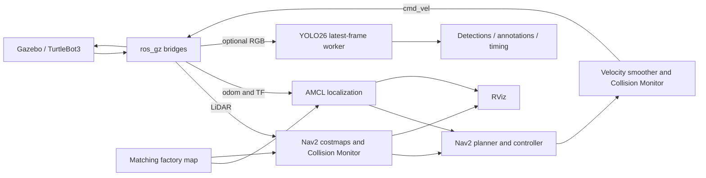

# Architecture

The detector is a non-controlling perception layer. LiDAR geometry and the
existing Nav2 command chain remain responsible for navigation and collision
avoidance. There is no metric camera–LiDAR association or semantic stop arbiter.

The SDF camera-link position `(0.069, -0.047, 0.107)` matches the upstream URDF
camera joint plus RGB joint offsets. Images use `camera_rgb_optical_frame`,
whose optical rotation is provided by that URDF. Gazebo generates intrinsics
from the field of view and image dimensions and bridges them as CameraInfo.
These are configured simulation parameters, not real-camera calibration.

The detector retains one inference job and the newest frame. Camera callbacks
do not run the model. It discards stale input and results and limits PyTorch
CPU threads. Bounding boxes are pixel coordinates; metric object poses are
not estimated. Unknown pose covariance is marked with large diagonal values.

The 5 cm map is rasterized from the same static collision boxes used in Gazebo.
Station pads and floor markings have no collision and are absent from occupied
cells. The unexpected blockage is absent from the static map and must be seen
through the LiDAR obstacle layer.

Factory Nav2 changes are limited to initial pose, 0.35 m/s forward speed,
0.15 m/s reverse speed, 1.2 rad/s yaw speed, matching smoother limits, and
disabling MPPI trajectory visualization. Upstream planning, control, costmap,
inflation, recovery, and Collision Monitor plugins are retained.
