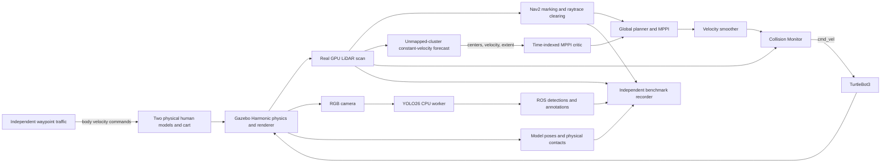

# Dynamic factory architecture

The advanced world is an additional mode. The original factory world, map,
launch file, and obstacle test remain available. The baseline checkpoint is
`c342a41`; development is on `feature/dynamic-factory-navigation`.

YOLO publishes observations only. Navigation uses LiDAR, localization, costmaps,
and Nav2; it does not consume YOLO output. MPPI evaluates candidate **robot**
trajectories. A separate sensor-based node estimates obstacle motion from successive
LiDAR clusters, not actor ground truth or scripted routes. This is a limited
obstacle-motion forecast, not pedestrian intent prediction.

## LiDAR forecast and heading correction

`forecast.py` transforms real scan points into odom and excludes returns within
0.20 m of static-map obstacles. It groups adjacent unmapped returns, matches
successive cluster centers within 0.65 m, and smooths the measured velocity.
Circular arcs are fitted from measured returns when well conditioned. Flat
surfaces use whole-cluster rectangle-boundary residuals to fit orientation and
declared 1.0 × 0.7 m box size priors to estimate an occluded face. These
priors are configurable on the forecast node and must be recalibrated when
industrial-object dimensions change. This is geometric model fitting, not
YOLO-based semantic control. Fitted centers inside the static map are rejected.
A track needs six observations and speed above 0.08 m/s; estimates are capped
at 0.65 m/s. Observed surfaces are translated by that velocity at 0.5, 1.0,
1.5 and 2.0 s and published on `/dynamic/predicted_obstacles` for visualization
only. Raw `/scan` is unchanged and is the only costmap observation source.
`/dynamic/tracked_obstacles` carries measured centers with velocity and extent
channels to the compiled MPPI critic. The original profile does not load that
critic. Tracking still runs for observation in both profiles; this is an
integrated controller-profile comparison. Both share the physical footprint,
speed caps, scenario pose and 0.35 m / 20 s progress checker. The original
factory launch and its overrides remain unchanged.

The forecast subscribes to scan, map, clock and ordinary TF only. Ground-truth
poses are read by the evaluator, never the forecast or Nav2. It has no velocity
publisher. `prediction_observations.jsonl` records the estimates; the offline
`evaluate_forecasts.py` compares them with Gazebo truth without feeding that
truth back into control. Acceleration, occlusion and reversals limit constant
velocity forecasts, and partially visible surfaces bias their centroids.

`factorynav_mppi_critics` implements `mppi::critics::DynamicObstacleCritic`
through Nav2's actual plugin API. For every sampled robot trajectory it compares
each robot position with the obstacle estimate at that same future time over
the 4.8 s horizon. A 0.30 m robot disk, 0.08 m margin and growing uncertainty
make the soft collision cost conservative. Actual observed collisions remain
subject to the standard footprint-aware CostCritic and Collision Monitor.
Track data expires after 0.4 s. No predicted points are injected into costmaps.

A terminal cost extrapolates relative motion from the candidate endpoint,
using its estimated ending velocity rather than assuming the robot stops.
Its additional 8 s lookahead is a conservative risk heuristic, not a validated
human forecast. It discourages waiting in an approaching obstacle's path while
allowing safe continued motion through a crossing. A soft angular-travel cost
discourages full turns; it is relaxed within 1 m of the goal so normal final
position and heading corrections can complete.
The earlier rotation-shim and spatial-forecast prototypes are retained in
development evidence but are not used by the final profile.

## Map and traffic

The world spans 21 × 16 m inside its boundary walls. The occupancy grid has
0.05 m cells and is generated from the same obstacle specification as the SDF.
Seven stations surround four racks, manufacturing equipment, crossing aisles,
outer loops, and a 0.95 m dead-end bay. The central aisle is 4.8 m wide.
`scripts/generate_dynamic_factory.py` checks station connectivity using a
conservative 0.31 m disk and checks an alternate route after blocking one
corridor. These geometry checks are separate from actual Nav2 action results.

Each human is one dynamic rigid link with a textured standing-person mesh,
1.8 m tall cylinder collision of radius 0.28 m, and a visible ankle-level proxy
with the same radius. Gazebo GPU LiDAR detects visuals, so that proxy makes
the scan-height geometry explicit. The mesh and collision move together.
People translate and turn; there is no animated walking gait.

The orange industrial cart has a 1.0 × 0.7 × 0.8 m collision box and visible
payload. Its controller, like the pedestrian controllers, subscribes only to
its own model pose and simulation clock. It ramps speed and publishes body
velocity to Gazebo VelocityControl at 20 Hz. It never reads robot pose, changes
robot pose, or chooses an avoidance maneuver for the robot. Gravity is disabled
on these upright proxies; collision response is enabled. The isolated contact
calibration demonstrates physical contact and robot displacement.

The full traffic scenario keeps both humans and the cart moving on loops until
shutdown. The human crossing the left aisle, the human in the central aisle,
and the cart in the right aisle use spatially separated routes to avoid
agent-to-agent collisions masking robot navigation behavior.

## Instrumentation and definitions

Gazebo PosePublisher supplies model ground truth on `/dynamic/robot_pose` and
`/dynamic/{human_a,human_b,cart}/pose`, separate from localization TF. The robot
uses genuine NavigateToPose actions. Ground truth is used for evaluation only.

At 10 Hz the recorder saves oriented robot footprint, agent poses, odometry,
final velocity command, and clearances. The robot rectangle is
`x=[-0.22,0.16], y=[-0.20,0.20]` m. Circle/rectangle distances measure human
clearance; oriented rectangle distances measure cart and static geometry
clearance. Negative values indicate overlap of the conservative 2D proxies.
These are sampled geometric estimates, not a continuous collision proof.
The advanced costmaps pad the physical rectangle by 0.05 m for planning;
evaluation continues to use the physical rectangle so the measured gap is
not inflated by that safety buffer.

Robot and traffic contact sensors bridge `gz.msgs.Contacts` to
`ros_gz_interfaces/msg/Contacts`. Floor contacts are excluded from collision
events. Collision pairs are deduplicated over 0.3 s. A deliberate contact probe
is a sensor calibration, **not** a successful safe navigation experiment.

Real scan endpoints are transformed into map coordinates and compared with
agent boundary geometry every 0.5 s (0.16 m tolerance accounts for scan/pose
timing and localization). The local costmap is published in full and sampled
over each agent footprint. Marking means a peak occupancy value ≥99. Clearing
means a previously marked location falls below 50 after the actor moves more
than 1 m and the location remains inside the rolling grid. Not every encounter
provides a clearing observation because the grid moves or the actor is occluded.
Raw observations and one costmap snapshot accompany each applicable run.
The final grid includes current raw scan returns. The forecast preview is
visually separate and does not contribute occupancy to the grid.

Stopped time uses measured ground-truth speed <0.02 m/s. Slowing time uses
0.02–0.24 m/s. Near-agent time uses center distance <2.5 m. A head-on run is
classified as continuous passing only if the action succeeds without contact
or geometric overlap, relative longitudinal order changes, lateral offset
exceeds 0.45 m, nearby travel exceeds 0.5 m, and no nearby stop lasts 1.5 s.
The report also lists actual stop time and clearance rather than relying on
that classification alone. Terminal goal settling can add stopped time away
from the encounter.

Perception metrics retain source-image timestamps, boxes and confidence. The
full-mission moving-human count combines a person detection with a moving
human in the geometric camera frustum; multiple humans can be present, so it
does not establish detection identity or resolve occlusion. A separate
single-human camera run can be audited with `verify_single_person_run.py`.
It requires at least three distinct positive source frames spanning over a
second while the only human moves above 0.05 m/s in the frustum, actual ROS
person arrays, and changing box widths. The audit also reports the actor's
motion at the saved best-image timestamp. Its truth association is offline
evaluation and never feeds control.

## Runtime and preserved safety

The active navigation command chain is controller → velocity smoother → Collision Monitor
→ Gazebo. Collision Monitor's existing footprint-approach safety behavior stays
enabled. No semantic node or benchmark publishes robot motion commands.
Headless tests still use Xvfb for real software-rendered GPU LiDAR. GUI mode
adds Gazebo, RViz, and the original loopback-only noVNC desktop. ROS time drives
traffic and metrics; wall time and Docker CPU/memory samples are also retained.
The advanced launch derives a GUI configuration from the world's existing
visual plugins and explicitly sets an 800 × 875 window beside RViz. This uses
Gazebo's supported [GUI configuration](https://gazebosim.org/api/sim/8/gui_config.html)
and [window layout](https://gazebosim.org/api/gui/8/layout.html), avoiding its
default width covering the neighboring window.

The installed Nav2 docking server also advertises a `/cmd_vel` publisher but
is not invoked by these navigation experiments. The runtime graph is saved in
`dynamic_runtime_graph.txt`. Publisher GIDs are unavailable in this rclpy
callback metadata, so the recorder does not claim per-publisher attribution.

The advanced launcher starts Gazebo directly before spawning the generated
robot, avoiding an upstream temporary-xacro startup race observed during
development. Useful failure logs remain under `docs/dynamic_test_runs/`.
