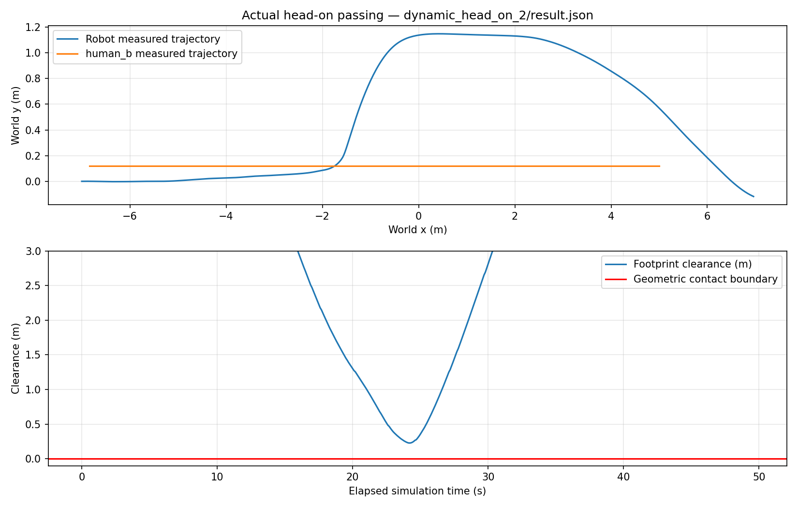
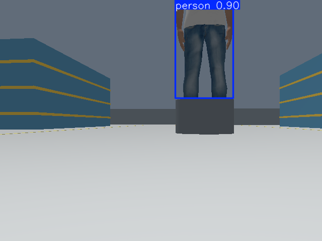
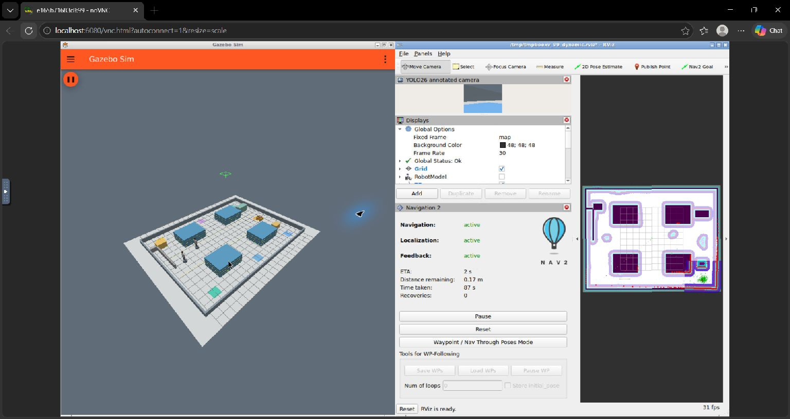

# Measured dynamic navigation results

These results come from real Gazebo physics, rendered sensors, and Nav2 actions on the local Windows/Docker host. No trajectory was prescribed to the robot. Each final trial starts in a fresh container. Head-on/alongside variants change actor offset; crossing/cart variants change start delay. Full missions repeat the same independent traffic routes. MPPI sampling is stochastic. This is a small simulation benchmark, not a real-world safety validation.

Final evidence is in [`dynamic_test_runs/validation`](dynamic_test_runs/validation). Every directory contains action results, full trajectories, contacts, LiDAR/costmap observations, effective parameters, source hashes and resource samples. `success` requires goal success, no non-floor robot contact or sampled footprint overlap, at least 0.08 m physical clearance, moving actors observed by LiDAR, local costmap marking, and the applicable passing/wait behavior. Individual acceptance checks are saved.

The [sealed benchmark source bundle](dynamic_test_runs/validation/benchmark_sources.zip) preserves all recorded source bytes and line endings across Git/platform normalization. The recorded launch hash also matches [`benchmark_launch_snapshot.py`](dynamic_test_runs/validation/benchmark_launch_snapshot.py). After benchmarking, the launch received GUI-only changes: an explicit Gazebo window size and RViz zoom to fit the map. Controller parameters, navigation code, traffic and geometry remain the benchmarked versions. The final GUI is checked separately.

| Scenario | Successful / trials | Mean goal time (sim s) | Min actor clearance (m) | Max nearby stopped time (s) | Contacts | Max recoveries |
|---|---:|---:|---:|---:|---:|---:|
| head_on | 3/3 | 47.69 | 0.227 | 0.00 | 0 | 0 |
| crossing | 3/3 | 38.83 | 0.774 | 1.10 | 0 | 0 |
| alongside | 3/3 | 64.52 | 0.524 | 0.89 | 0 | 0 |
| cart | 3/3 | 58.97 | 0.087 | 7.00 | 0 | 0 |
| full | 3/3 | 178.25 | 0.109 | 0.80 | 0 | 0 |

Continuous head-on passing classification: **3/3**. Classification requires a change in longitudinal order, lateral motion, measured progress near the actor, no long nearby stop, and no contact/overlap. The [measurement definitions](dynamic_factory_architecture.md) give thresholds.

Advanced trials meeting the sampled 0.08 m clearance margin: **17/17**. All timing, stopped time, and minimum-distance values are measured, including terminal goal settling.

## Sensors, contacts and re-entry

The isolated [`physical_v1/dynamic_contact_probe_0`](dynamic_test_runs/physical_v1/dynamic_contact_probe_0/result.json) deliberately drives a human into a stationary robot. Gazebo reports the human/camera collision pair and the robot is displaced 1.77 m. This confirms physical interaction and contact transport; it is excluded from navigation success rates. The first static run predates the corrected contact topic and uses complete-run geometric clearance instead.

| Scenario | LiDAR samples matching actor boundary | Local lethal-mark samples | Old-location clearing observations |
|---|---:|---:|---:|
| head_on | 279 | 74 | 6 |
| crossing | 238 | 150 | 13 |
| alongside | 392 | 392 | 33 |
| cart | 358 | 233 | 13 |
| full | 1447 | 282 | 10 |

The saved trajectories identify **10 actor/run pairs** where the robot later enters a previously occupied actor footprint after the actor has departed. Marking and clearing are measured from ROS costmap messages, never injected from ground truth. An actor outside the rolling grid or behind an occlusion may have zero local marking/clearing observations; consult its individual log.

Additional final-profile safety scenarios:

| Scenario | Accepted | Sim time (s) | Min actor clearance (m) | Nearby stopped time (s) | Contacts | Recoveries |
|---|---|---:|---:|---:|---:|---:|
| blocked | True | 41.26 | 0.359 | 11.80 | 0 | 15 |
| cart_shared | True | 53.05 | 0.187 | 0.80 | 0 | 0 |

The blocked case uses the 0.95 m dead-end bay, where passing beside a human is geometrically impossible. Its acceptance requires a measured wait followed by progress. `cart_shared` tests an approaching cart in the open central corridor. Recovery feedback is reported even when a goal eventually succeeds.

## Sensor motion estimates

The following offline evaluation associates active sensor tracks with the nearest Gazebo actor within 0.9 m. Truth is used only for evaluation. Error columns show the range of per-trial medians; p95 is the largest trial p95. Two-second errors compare displacement, excluding initial center-estimation bias. Unassociated tracks are counted rather than silently treated as accurate.

| Scenario | Associated / active estimates | Median velocity error range (m/s) | Worst p95 velocity error (m/s) | Median 2 s displacement error range (m) | Worst p95 2 s error (m) |
|---|---:|---:|---:|---:|---:|
| head_on | 479/479 | 0.026–0.030 | 0.121 | 0.049–0.058 | 0.249 |
| crossing | 820/820 | 0.030–0.031 | 0.145 | 0.068–0.075 | 0.333 |
| alongside | 1893/1893 | 0.018–0.020 | 0.048 | 0.034–0.040 | 0.134 |
| cart | 1303/1303 | 0.039–0.043 | 0.318 | 0.081–0.089 | 0.693 |
| full | 2073/2304 | 0.049–0.056 | 0.547 | 0.136–0.156 | 1.092 |
| blocked | 164/164 | 0.043–0.043 | 0.374 | 0.088–0.088 | 0.749 |
| cart_shared | 215/215 | 0.039–0.039 | 0.300 | 0.082–0.082 | 0.589 |

Reversals, acceleration, occlusion and partial surfaces limit these constant-velocity estimates. The declared 1.0 × 0.7 m rectangular size prior supplies an occluded cart dimension, never its position, velocity or route. It must be changed and revalidated for different equipment.

## Multi-station mission and YOLO

The mission is Loading → Assembly → Quality inspection → Delivery. Both humans and the cart remain independently active throughout all three navigation goals. Agent travel distances and timestamps in every result/trajectory verify continued motion.

| Run | Goal statuses | Sim time (s) | ROS person arrays | Person frames with moving human in camera frustum | Best confidence | Median inference (ms) |
|---|---|---:|---:|---:|---:|---:|
| 0 | 4, 4, 4 | 183.51 | 24 | 23 | 0.859 | 36.180 |
| 1 | 4, 4, 4 | 173.36 | 28 | 27 | 0.865 | 35.810 |
| 2 | 4, 4, 4 | 177.89 | 25 | 21 | 0.871 | 36.275 |

Action status 4 means SUCCEEDED. The moving-human count combines actual person detections with ground-truth motion and camera-frustum checks at source-image timestamps; it is not identity tracking or depth estimation. Inference uses CPU. `/perception/detections` carries actual `vision_msgs/Detection2DArray` messages and `/perception/annotated` carries images. YOLO does not command the robot.

This actual annotated frame is from the separate [single-human GUI camera trial](dynamic_test_runs/gui_head_on/dynamic_head_on_0/single_person_validation.json), source timestamp 25.800 s. The only human is moving at 0.221 m/s at that timestamp. The offline audit finds 32 distinct positive moving-human frames spanning 17.80 s, with changing bounding boxes and actual ROS person arrays. This extra GUI trial is excluded from the 17-run main matrix.

## Runtime

For the headless final matrix, Docker CPU median across sampled startup/navigation intervals is 290.6% (100% is one logical core). Peak container memory: 1316 MiB. Navigation action real-time factor ranges from 0.977 to 1.000. Software rendering is enabled; CUDA inference was not used. Raw resource samples are retained rather than presenting these small runs as hardware performance guarantees.

## Additional GUI checks

| Trial | Accepted | Sim time (s) | Min actor clearance (m) | Contacts | Recoveries | Median inference (ms) |
|---|---|---:|---:|---:|---:|---:|
| [gui_head_on/dynamic_head_on_0](dynamic_test_runs/gui_head_on/dynamic_head_on_0/result.json) | True | 47.24 | 0.257 | 0 | 0 | 142.910 |
| [gui_live_full](dynamic_test_runs/gui_live_full/result.json) | True | 168.25 | 0.280 | 0 | 0 | 126.890 |
| [gui_layout_final](dynamic_test_runs/gui_layout_final/result.json) | True | 191.13 | 0.276 | 0 | 0 | 102.325 |

These additional trials are excluded from the 17-run headless matrix and its resource summary. `gui_live_full` enables MPPI candidate visualization; `gui_layout_final` verifies the corrected default layout with debug visualization disabled. Software GUI rendering increases inference latency. [Recorded topic connections](dynamic_gui_topics.txt) confirm the MarkerArray publisher and RViz subscriber, plus the annotated camera subscription. [Source verification](dynamic_source_verification.json) checks all 20 benchmark source sets against the preserved launch and current navigation/traffic code, and confirms identical Nav2 parameters for the final GUI and full benchmark.

## Preserved baseline and development failures

- Original factory regression: SUCCEEDED, 25.903 s; original unexpected-obstacle detour: SUCCEEDED, 45.203 s. Their evidence is retained as `regression_factory.json` and `regression_dynamic.json`.
- The complex static mission reached all six destinations after the Loading start: 70.540 m travel, 246.753 sim s across goals, zero recoveries, 0.238 m minimum sampled static footprint clearance.
- An initial local-layer configuration omitted the per-scan maximum obstacle height, leaving the local grid empty. The explicit 2 m height filter fixes it. Earlier `physical_v1` and `comparison_v2` dynamic runs are development evidence, not final local-layer validation.
- The first crossing pilot contacted a wheel and later aborted. Its full evidence remains in `scenario_pilots/dynamic_crossing_0`. The path-angle critic previously looked only four path points ahead; increasing that to 20 points and its weight to 4 removed the observed full-turn trap in the successful retests. Repeated final outcomes are listed above.
- Repeated tuning exposed smaller margins and contacts in some variants. Increasing padding alone did not solve it; spatially projected future occupancy and a rotation shim also failed stress cases. These development records remain under `margin_v2`, `margin_v4`, `horizon_v6`, `forecast_v8`, `shim_v9`, and later prototype directories. The [tuning history](dynamic_tuning_history.md) records the sequence.
- A repeated cart trial exposed unstable rectangle yaw and false lateral velocity from adjacent-ray noise. The whole-cluster boundary-residual orientation fit fixes that observed failure; a noisy-corner unit test and a fresh complete matrix accompany it. The earlier matrix remains in `pre_robust_box_v15`.
- The final design keeps scan-only costmaps and loads a native time-indexed MPPI critic. It scores simultaneous robot/obstacle positions, adds a terminal continued-motion risk cost using relative endpoint velocity, and discourages excessive angular travel outside the final metre of the goal. The final table includes every completed repeated outcome, including any failure.
- The headless upstream xacro startup race and contact-topic placement were diagnosed and corrected. See the implementation checklist and retained diagnostics.

## Post-change original-mode regressions

| Check | Passed | Wall time (s) | Evidence |
|---|---|---:|---|
| Original factory | True | 25.902 | Nav2 action status 4 |
| Original dynamic | True | 45.802 | Nav2 action status 4 |
| Original YOLO camera | True | 15.00 | 25 person frames; 22 matching stamps; calibrated CameraInfo and optical TF |

Raw results are the `regression_*_final.json` files in `dynamic_test_runs/`. These reruns use the original world and launch after the advanced implementation changes.

## Demo and limits

The map, trajectory plot and camera frames accompany the measurements. The [105-second recording plan](demo_script.md) uses labeled clips from separate experiments. The [command reference](dynamic_commands.md) covers launch, optional perception, actor activation, missions, tests and cleanup.

Limitations: standing meshes translate without a walking gait; traffic uses upright rigid proxies and predetermined routes; no human intent prediction, semantic navigation control, tracking identity, or validated CUDA inference is implemented. Safety measurements sample conservative planar geometry at 10 Hz plus physics contacts. The cart trials include a tight 0.087 m margin and a 7 s nearby wait; continuous zero-stop behavior is demonstrated specifically by the head-on trials. Other layouts, equipment dimensions, higher speeds and real robots require further validation.
